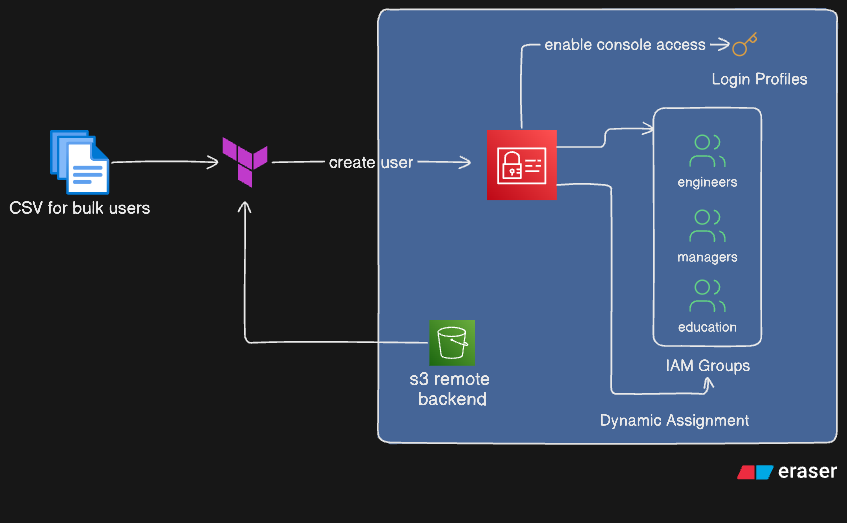

#AWS IAM User and Group Management Using Terraform

## 📌 Project Overview

This project demonstrates how to automate AWS Identity and Access Management (IAM) user creation, login profile configuration, group creation, and group membership management using Terraform Infrastructure as Code (IaC).

User information is maintained in a CSV file (users.csv), which serves as the centralized data source for provisioning IAM users and assigning them to groups based on their department and job title.

The primary goal of this project is to make IAM administration more consistent, repeatable, and easier to maintain while reducing manual configuration through the AWS Management Console.

## 🎯 Project Objectives
- Automate AWS IAM user creation using Terraform.
- Use a CSV file as the source of user information.
- Generate IAM usernames dynamically from first and last names.
- Configure IAM user login profiles with mandatory password resets.
- Create IAM groups for Education, Managers, and Engineers.
- Assign users to groups dynamically based on department and job title.
- Use Terraform expressions, for_each, conditional filtering, and data sources.
- Demonstrate Infrastructure as Code principles and configuration management.

## 🏗️ Architecture


<!-- ```
The project follows a data-driven provisioning workflow.

             users.csv
                 |
                 v
        Terraform csvdecode()
                 |
                 v
          local.users
                 |
                 v
        Create IAM Users
                 |
                 v
       Configure Login Profiles
                 |
                 v
          Create IAM Groups
                 |
                 v
      Evaluate Membership Rules
                 |
       +---------+---------+
       |         |         |
       v         v         v
   Education  Managers  Engineers
       |         |         |
       +---------+---------+
                 |
                 v
         AWS IAM Resources
                 |
                 v
         Terraform Outputs
``` -->

#### Technologies Used
- AWS IAM: Identity and access management for users and groups.
- Terraform: Infrastructure provisioning and lifecycle management.
- AWS Provider: Integrates Terraform with AWS services.
- CSV: Stores user information in a structured format.
- HCL: Defines the infrastructure configuration.
- AWS CLI: Can be used to configure credentials and verify deployed resources.


## 📁 Project Structure
```
terraform-aws-iam-management/
├── main.tf           # IAM users, login profiles, groups, memberships
├── variables.tf      # Input variables, including AWS region
├── outputs.tf        # Terraform outputs
├── users.csv         # User information and group assignment attributes
├── providers.tf      # Terraform and AWS provider configuration
├── .gitignore        # Excludes local and sensitive files
└── README.md         # Project documentation
```

> Note: This structure is a recommended organization. Your current configuration can be split into these files without changing the overall design.

## ⚙️ How It Works
### 1. User Data Management with CSV

The users.csv file contains the information required to provision IAM users.

Example:
```
first_name,last_name,department,job_title
Michael,Scott,Education,Regional Manager
Dwight,Schrute,Sales,Assistant to the Regional Manager
Jim,Halpert,Sales,Sales Representative
Robert,California,Corporate,CEO
```

Terraform reads and decodes the CSV file:

```
locals {
  users = csvdecode(file("users.csv"))
}
```

The `csvdecode()` function converts CSV records into a list of objects that Terraform can reference throughout the configuration.

**Benefits:**
- Separates user data from infrastructure configuration.
- Makes onboarding additional users easier.
- Reduces repetitive resource definitions.
- Enables consistent, data-driven provisioning.


### 2. Dynamic IAM User Creation

IAM users are created using for_each:
```
resource "aws_iam_user" "users" {
  for_each = {
    for user in local.users : user.first_name => user
  }

  name = lower(
    "${substr(each.value.first_name, 0, 1)}${each.value.last_name}"
  )

  path = "/users/"

  tags = {
    DisplayName = "${each.value.first_name} ${each.value.last_name}"
    Department  = each.value.department
    JobTitle    = each.value.job_title
  }
}
```

The username is generated using the first letter of the first name and the full last name, converted to lowercase.

Examples:
```
Full name	Generated username
Michael Scott	mscott
Dwight Schrute	dschrute
Jim Halpert	jhalpert
Robert California	rcalifornia
```
User tags capture display names, departments, and job titles, providing useful metadata for administration and reporting.

### 3. IAM Login Profile Creation

The following resource creates a console login profile for each IAM user:
```
resource "aws_iam_user_login_profile" "users" {
  for_each = aws_iam_user.users

  user                    = each.value.name
  password_reset_required = true

  lifecycle {
    ignore_changes = [
      password_length,
      password_reset_required
    ]
  }
}
```

Each login profile is associated with an IAM user, and the initial password is configured to require a reset at first sign-in.

Security consideration: Terraform can handle sensitive login-profile information. Avoid exposing generated passwords in outputs, logs, or version control. This project reports a status message rather than the actual password.

The ignore_changes lifecycle rule prevents Terraform from attempting to reconcile changes to the specified attributes after creation. Use this behavior deliberately because it can also prevent Terraform from enforcing subsequent configuration changes.

### 4. AWS Account Identification

The AWS account ID is retrieved through the AWS caller identity data source:
```
data "aws_caller_identity" "current" {}
```

This avoids hardcoding the account ID.

The account ID can be exposed through an output:
```
output "account_id" {
  value = data.aws_caller_identity.current.account_id
}
```
### 5. IAM Group Creation

The project creates three IAM groups:
```
Group	Purpose
Education	Members whose department is Education
Managers	Members whose job titles match Manager or CEO
Engineers	Members whose department is Engineering
```
Example:
```
resource "aws_iam_group" "education" {
  name = "Education"
  path = "/groups/"
}
```

The Managers and Engineers groups follow the same resource pattern.

These groups provide a foundation for centralized permission management. In a production environment, attach appropriately scoped IAM policies to groups instead of assigning permissions individually to users.

### 6. Dynamic Group Membership

Memberships are calculated from the attributes stored in the CSV file.

**Education group**
```
users = [
  for user in aws_iam_user.users :
  user.name if user.tags.Department == "Education"
]
```

This selects users whose Department tag is Education.

**Managers group**
```
users = [
  for user in aws_iam_user.users :
  user.name
  if contains(keys(user.tags), "JobTitle")
  && can(regex("Manager|CEO", user.tags.JobTitle))
]
```

This selects users whose job titles match the configured Manager or CEO patterns.

The matching is case-sensitive and can match substrings. For example, Assistant to the Regional Manager also matches Manager. A future improvement would use normalized job titles or an explicit group-assignment field to make membership rules more predictable.

**Engineers group**
```
users = [
  for user in aws_iam_user.users :
  user.name if user.tags.Department == "Engineering"
]
```

The current CSV contains no Engineering department users, so the Engineers group is expected to have no members.

### 7. Terraform Outputs

The project exposes useful information after provisioning.

- Account ID
- Returns the AWS account ID associated with the configured credentials.
- User information

- The current user_names output returns local.users, which contains the complete decoded CSV records rather than just usernames. Consider changing it to:
```
output "user_names" {
  value = [
    for user in aws_iam_user.users : user.name
  ]
}
```

- Login profile status

The user_passwords output returns status messages indicating that initial passwords were created and users must reset them on first login. It does not expose actual password values.

The output name could be improved to login_profile_status to describe its contents more accurately.

## 🚀 Prerequisites

Before running the project, ensure you have:

- An AWS account.
- Terraform CLI installed.
- AWS CLI installed and configured.
- AWS credentials with permissions to manage the IAM resources used by this project.
- A terminal or shell environment.
- Git installed if you intend to clone or publish the repository.

Verify your installations:
```
terraform version
aws --version
git --version
```

Configure AWS credentials using an appropriate profile or environment-based credential mechanism. Avoid hardcoding access keys in Terraform files.

## 🛠️ Setup and Deployment
#### Step 1: Clone the repository

```
git clone <YOUR_REPOSITORY_URL>
cd terraform-aws-iam-management
```

Replace the placeholder with your repository URL.

#### Step 2: Configure AWS credentials

For example, configure a named AWS CLI profile:
```
aws configure --profile terraform
```
Verify the identity:
```
aws sts get-caller-identity --profile terraform
```

Use a suitably restricted IAM identity or role with the required permissions.

#### Step 3: Initialize Terraform
```
terraform init
```

This downloads the required providers and initializes the working directory.

#### Step 4: Validate the configuration
```
terraform fmt -recursive
terraform validate
```

These commands format the configuration and check it for syntax and configuration errors.

#### Step 5: Review the execution plan
```
terraform plan -out=tfplan
```

Review the planned changes carefully before applying them. Confirm that usernames, groups, and memberships are correct.

#### Step 6: Apply the configuration
```
terraform apply tfplan
```

Terraform provisions the resources described in the configuration.

#### Step 7: Review outputs
```
terraform output
```

To retrieve a specific output:
```
terraform output account_id
terraform output user_names
```
#### Step 8: Verify resources in AWS

Use the AWS Console or CLI to inspect the created users and groups.
```
aws iam list-users
aws iam list-groups
aws iam list-groups-for-user --user-name mscott
```

These commands use the default AWS CLI profile. Add --profile terraform if required.

## 🧪 Expected Results

After a successful deployment, the environment should contain:

- IAM users corresponding to the CSV records.
- Console login profiles for the provisioned users.
- The Education, Managers, and Engineers IAM groups.
- Education membership for Michael Scott.
- Manager-related membership for Michael Scott.
- CEO-related membership for Robert California and Jo Bennett.
- No members in the Engineers group unless Engineering users are added to the CSV.

Additional users may belong to more than one group if they satisfy multiple membership rules.

The exact resource count can vary if the CSV is changed or resources already exist in the AWS account.

## 📚 Key Learnings

This project provides hands-on experience with the following concepts.

#### Terraform fundamentals
- Infrastructure as Code and declarative resource management.
- Terraform initialization, validation, planning, and applying changes.
- Resource references and dependency management.
- Input variables, local values, and output values.
- Lifecycle configuration and ignore_changes.
#### Advanced HCL expressions
- for_each for managing multiple resources.
- for expressions for transforming and filtering collections.
- csvdecode() and file() for reading structured input.
- substr() and lower() for string manipulation.
- contains(), keys(), can(), and regex() for conditional logic.
#### AWS IAM concepts
- IAM users, groups, and login profiles.
- Resource paths and tagging conventions.
- Group-based identity organization.
- Account identification using AWS data sources.
- Least-privilege access and credential security considerations.
#### Automation and maintainability
- Separating data from infrastructure code.
- Reducing duplicated configuration.
- Applying consistent resource naming conventions.
- Automating group membership using user attributes.
- Managing changes through version-controlled configuration.

<!-- ## 🔐 Security Considerations

IAM resources affect account security, so this project should be treated as a learning environment until additional controls are implemented.

Use least privilege: Grant Terraform only the AWS permissions necessary to manage the intended resources.
Protect credentials: Never commit AWS access keys, secret keys, generated passwords, or sensitive Terraform state to Git.
Protect state files: Terraform state may contain sensitive information. Use a secure remote backend with encryption, access controls, and appropriate state-locking support.
Review plans: Inspect changes before applying them, especially when users or memberships are removed.
Prefer temporary credentials: Use IAM roles and short-lived credentials where possible.
Avoid routine IAM users for workforce access: For real organizations, evaluate IAM Identity Center or federation with an identity provider.
Review console access: Create login profiles only for users who need AWS Management Console access.
Avoid unnecessary password outputs: Status-only outputs are preferable to exposing credentials.

Important: Requiring a password reset does not replace MFA, secure credential delivery, or an appropriate identity lifecycle process. Use MFA and centralized identity management where appropriate. -->

<!-- 🔮 Future Improvements

The following enhancements can make the project more scalable, secure, and production-ready.

1. Add input validation

Validate CSV fields and enforce unique usernames. The current for_each map uses first_name as its key, so duplicate first names cause a Terraform error. Generated usernames can also collide when users share a surname or first initial.

A better design would use a unique employee ID or an explicitly defined username as the key.

2. Improve group assignment logic

Move group assignment into a dedicated CSV column or a separate mapping file instead of relying solely on job-title regular expressions.

For example:

first_name,last_name,department,job_title,groups
Michael,Scott,Education,Regional Manager,"Education;Managers"
Robert,California,Corporate,CEO,"Managers"


This makes access assignments easier to audit and reduces unexpected matches. The parsing logic would need to split and validate the groups field.

3. Add IAM policies

Create and attach appropriately scoped IAM policies to groups. Avoid granting broad permissions such as administrator access unless there is a clearly justified requirement.

4. Implement a secure password strategy

Evaluate AWS-managed identity options, federation, or a secure onboarding process for initial credentials. Avoid exposing generated passwords through Terraform outputs.

5. Separate environments

Support development, testing, and production environments using separate configurations or carefully designed reusable modules.

6. Refactor into Terraform modules

Separate IAM users, IAM groups, and membership management into reusable modules to improve maintainability and reusability.

7. Add automated testing and CI/CD

Introduce a workflow using GitHub Actions or another CI/CD platform to run:

terraform fmt -check -recursive
terraform validate
Terraform plan reviews.
Static security analysis using tools such as Checkov or TFLint.

Use appropriate credentials and approval controls before deploying changes to AWS.

8. Implement remote state management

Configure a remote S3 backend with encryption, restrictive access policies, versioning, and a supported locking mechanism. Keep state separate between environments.

9. Add IAM Identity Center support

For workforce access at organizational scale, investigate AWS IAM Identity Center and identity federation rather than provisioning individual IAM users with long-lived credentials.

10. Improve documentation and observability

Add deployment screenshots, a sample Terraform plan, architecture diagrams, troubleshooting guidance, and automated validation of the CSV input. -->

## 🧹 Cleanup

To remove the resources managed by this configuration, run:
```
terraform plan -destroy
terraform destroy
```

Review the destruction plan before confirming.

Warning: This operation removes the Terraform-managed IAM resources. Do not run it against a shared or production account without verifying the impact. Resources not managed by this configuration are not automatically removed.

<!-- ⚠️ Known Limitations
The CSV file must exist at the configured path and contain the expected headers.
Duplicate first names can cause for_each key collisions.
Generated usernames can collide even when first names are unique.
The Managers rule uses case-sensitive regular-expression matching and may include unintended titles.
Group membership is limited to the three groups currently defined.
The project does not yet attach permissions policies to groups.
IAM login profiles are appropriate only when console password access is required.
Terraform state and generated credentials require secure handling. -->


